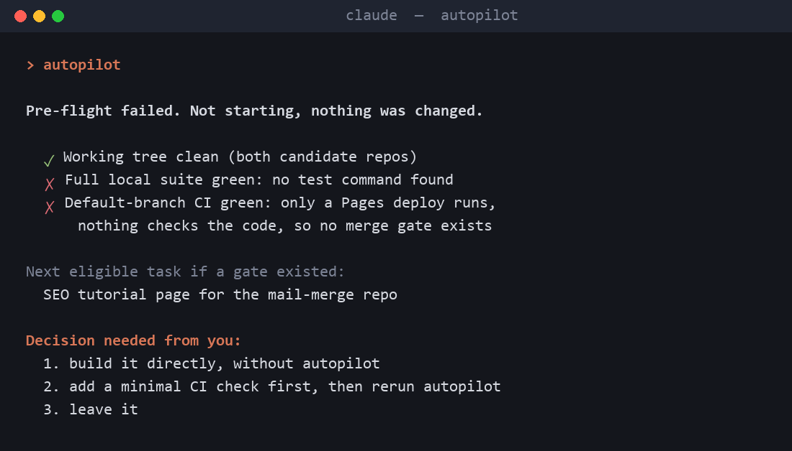

# Workflow Skills for Claude Code


Five skills that change how Claude Code works on long jobs.

| Skill | Say | What it does |
|---|---|---|
| **autopilot** | "autopilot" | Picks the one tracked task that can be finished with no human decision, builds it test-first, has an independent adversarial verifier check it, and lands it through a PR that auto-merges only if CI is green. Bails instead of guessing. |
| **wargame** | "wargame this" | Plans a task to an 8-point standard (expected observations, counter-moves, fork triggers, abort conditions, verification, red-team) so a cheaper model can execute it blind. |
| **delegate** | "/delegate" | Runs each step of a multi-step task in its own fresh subagent so the main thread stays lean. |
| **afk** | "afk" | Away-from-keyboard mode: no questions, sensible defaults, heavy compaction between tasks. |
| **prepare-for-next-session** | "wrap up" | Saves only durable, non-obvious state to memory and turns the session's mistakes into lessons. |

### What a bail-out looks like

Real output, abridged: autopilot refusing to start in a repo with no tests or CI to gate the merge, and asking for the one decision it needs.



## Install

```
/plugin marketplace add DecodedXR/claude-workflow-skills
/plugin install autopilot-wargame@decodedxr
```

In the VS Code extension, paste this into your browser's address bar to open the install dialog:

```
vscode://anthropic.claude-code/install-plugin?plugin=autopilot-wargame&marketplace=DecodedXR/claude-workflow-skills
```

Or copy any `skills/<name>` folder into `~/.claude/skills/`.

## Requirements

- Claude Code with plugin support.
- **autopilot**: a git repo with a test command, plus the GitHub CLI (`gh`, authenticated) to open the PR and watch CI. Without `gh` it bails before landing and reports where it stopped; it never pushes straight to the default branch.
- Everything else works in any project.

## Privacy

No data collection, network calls or telemetry. See [PRIVACY.md](PRIVACY.md).

## Also from DecodedXR

- [Heads-up](https://github.com/DecodedXR/heads-up): desktop notifications when Claude Code needs permission or finishes (Windows, macOS, Linux, WSL). `/plugin install heads-up@decodedxr`

## Support

Free forever. If these save you time, you can [pay what you want on Gumroad](https://decodedpc.gumroad.com/l/wsgyo).

## License

MIT. See `LICENSE`.
