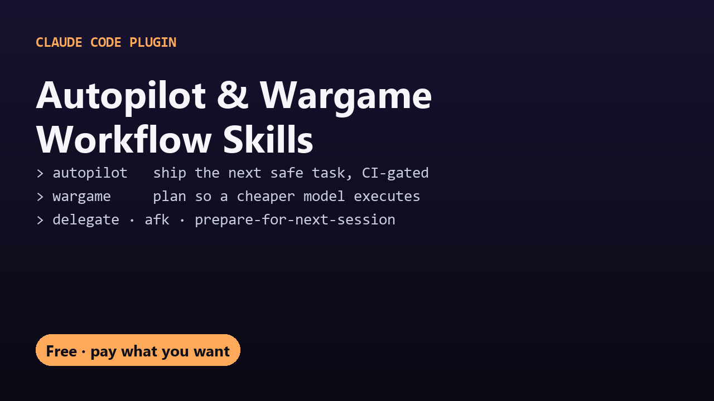

# Workflow Skills for Claude Code
n

Five skills that change how Claude Code works on long jobs.

| Skill | Say | What it does |
|---|---|---|
| **autopilot** | "autopilot" | Picks the one tracked task that can be finished with no human decision, builds it test-first, has an independent adversarial verifier check it, and lands it through a PR that auto-merges only if CI is green. Bails instead of guessing. |
| **wargame** | "wargame this" | Plans a task to an 8-point standard (expected observations, counter-moves, fork triggers, abort conditions, verification, red-team) so a cheaper model can execute it blind. |
| **delegate** | "/delegate" | Runs each step of a multi-step task in its own fresh subagent so the main thread stays lean. |
| **afk** | "afk" | Away-from-keyboard mode: no questions, sensible defaults, heavy compaction between tasks. |
| **prepare-for-next-session** | "wrap up" | Saves only durable, non-obvious state to memory and turns the session's mistakes into lessons. |

## Install

```
/plugin marketplace add DecodedXR/claude-workflow-skills
/plugin install workflow-skills@decodedxr
```

Or copy any `skills/<name>` folder into `~/.claude/skills/`.

## Support

Free forever. If these save you time, you can [pay what you want on Gumroad](https://decodedpc.gumroad.com/l/wsgyo).

## License

MIT. See `LICENSE`.
